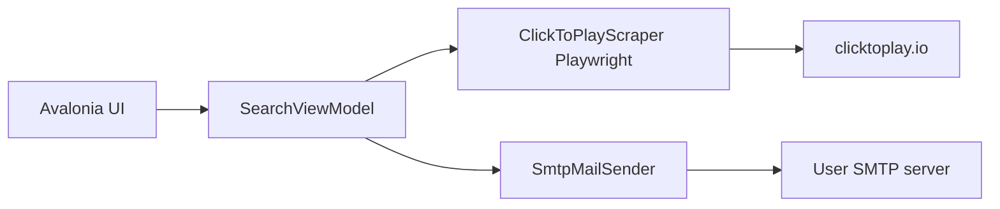

# ClickPlay availability desktop app

## Goal

A **.NET 8 Avalonia** app for **Windows and Mac** that:

1. Opens [https://clicktoplay.io/](https://clicktoplay.io/)
2. Fills a **Sport** dropdown from the site navigation
3. After a sport is chosen, fills a **City** dropdown from the booking city list for that sport
4. After sport **and** city are chosen, fills a **Locations** control with every club/venue for that pair; **multiple locations can be selected**
5. Lets the user set **how many days ahead** to search (text box) and **two time windows**: weekdays, and weekends plus holidays
6. Searches **all selected locations** for free hours in those windows
7. **Emails** the result via **SMTP** (user-configured)

## Architecture



- UI: Avalonia + CommunityToolkit.Mvvm
- Site access: Microsoft Playwright for .NET (matches the live JS UI: sport tabs, **Резервирай корт**, city **Град**, date/time, **With free hours**)
- Mail: MailKit SMTP
- Settings: local JSON in the user app-data folder (SMTP host/port/user/password/from/to). Do not commit secrets.

## AGENTS.md (project agent rules)

Create [`AGENTS.md`](h:\Softuni\Projects\ClickPlay\AGENTS.md) at the repo root. It is the source of truth for agents working in this repo.

### Cross-platform

- **Targets:** Windows and Mac only
- **Stack:** C#, Avalonia, Playwright
- **Libraries:** prefer cross-platform libraries and APIs (`Path.Combine`, `Environment.GetFolderPath`, `HttpClient`, MailKit, Playwright)
- **Hard rule:** do not introduce Windows-only dependencies into shared application code (`ClickPlay.Core`) without explicit justification (no `System.Windows.*`, `Microsoft.Win32`, WinForms, WPF, or Win32 P/Invoke in shared code)

### Coding standards

- .NET 8, nullable reference types on, file-scoped namespaces
- MVVM: Avalonia views bind to ViewModels; no Playwright or SMTP in code-behind
- Async all the way (`async`/`await`, `CancellationToken` on scrape and mail)
- UI updates on the Avalonia dispatcher; run Playwright off the UI thread
- Prefer `ILogger` / user-visible status text over `Console.WriteLine`
- Names: `PascalCase` types/methods, `_camelCase` private fields
- XML docs on public scraper and mail APIs
- No secrets in source; SMTP credentials only in local app-data settings

### Browser automation (Playwright)

- Use **Microsoft.Playwright** only; do not add Selenium or Windows-only WebView2 into shared code
- One browser/context lifecycle per search session; dispose with `await using`
- Default **headless**; optional “show browser” for debugging
- Wait for load state / locators (`WaitForSelectorAsync`, `Locator`) — no fixed `Thread.Sleep` except a documented last resort
- Prefer role/text locators that match Bulgarian UI (`Резервирай`, `Град`) with English fallbacks
- Dismiss cookie/language/location popups using the recovery procedure below
- Timeouts: navigation ~30s, element ~10s; cancel via `CancellationToken`
- Parse only visible club/city data; fail with a clear message if the site layout changed
- Do not log in, book, or submit payment
- Do not store ClickToPlay session cookies in git
- Install browsers via `playwright.ps1 install chromium` (documented for Win and Mac)

#### Overlay recovery (sports panel)

Implement this as a dedicated helper (e.g. `DismissBlockingOverlaysAsync`) and call it before interacting with the sports panel. Check **visibility** before every click (`Locator.IsVisibleAsync`). Do not click a button that is not visible.

1. Check whether a dialog or consent overlay is blocking interaction.
2. If the **Запази** button is visible, select **Български**, then click **Запази**.
3. If the **Приемам** button is then visible, click it.
4. Wait until the dialogs or overlays disappear (locator hidden / detached).
5. Retry interacting with the sports panel **once**.
6. If the panel remains unresponsive, capture a diagnostic screenshot and log the current page state (URL, title, visible overlay text). Save screenshots under the user app-data diagnostics folder — not a hardcoded machine path.

Important:

- Required sequence when those controls are present: **Български** → **Запази** → **Приемам** → sports panel
- Do not assume every sports-panel failure is caused by these dialogs
- Do not repeatedly click buttons without verifying the result (one attempt per visible button, then re-check visibility)

### Configuration, secrets, and site access

- Keep environment-specific settings outside source code (user app-data JSON or env vars; gitignore local settings)
- Do not commit credentials, private keys, tokens, or personal session data
- Do not hardcode user-specific paths or machine-specific configuration (use `Environment.GetFolderPath` / relative paths)
- Validate external data before using it in the application (HTML/JSON from clicktoplay.io, SMTP input, days-ahead integer, time windows)
- Follow the target website's applicable terms and access requirements ([clicktoplay.io](https://clicktoplay.io/) terms of use; no login, booking, or payment automation)

Project layout in the empty repo:

- [`AGENTS.md`](h:\Softuni\Projects\ClickPlay\AGENTS.md) — agent/cross-platform rules
- [`ClickPlay.sln`](h:\Softuni\Projects\ClickPlay\ClickPlay.sln)
- [`src/ClickPlay.App`](h:\Softuni\Projects\ClickPlay\src\ClickPlay.App) — Avalonia desktop
- [`src/ClickPlay.Core`](h:\Softuni\Projects\ClickPlay\src\ClickPlay.Core) — scraper, models, mail
- [`src/ClickPlay.App/app.manifest`](h:\Softuni\Projects\ClickPlay\src\ClickPlay.App) — Win/Mac `net8.0`

## UI flow

1. On launch, scrape sports from the homepage nav (Тенис, Падел, Пикълбол, Бадминтон, Футбол, Тенис на маса, Баскетбол, Волейбол, Плажен тенис, Плажен волейбол, Плуване, Скуош; include **Голф** if it appears in the booking filter).
2. **Sport** ComboBox. **City** is hidden until a sport is selected. **Locations** is hidden until both sport and city are selected.
3. On sport selected: load **Град** cities for that sport; clear City and Locations.
4. On city selected: scrape **all clubs/venues** for that sport + city (club cards on `clubs/index.php` after applying the city filter) and populate **Locations**. Changing city clears and reloads locations.
5. Locations is a **multi-select** list (checkboxes / `ListBox` `SelectionMode=Multiple`) plus **Select all** / **Clear**. One or more venues can be checked.
6. **Days ahead** is a **text box** (positive integer, default 7, validated before search). There are **no per-day rows**.
7. **Two time windows** (from/to), always visible:
   - **Weekdays** (Monday–Friday, unless the date is a holiday)
   - **Weekends and holidays** (Saturday, Sunday, and Bulgarian public holidays)
8. **Search** is enabled when sport, city, at least one location, a valid days-ahead value, and both windows are valid (from < to). For each date from today through days-ahead, apply the weekday window or the weekend/holiday window, then search **each** selected location.
9. Show results in the window and send the same report by email.

## Scraper behavior

Playwright Chromium (headless, with a “show browser” toggle for debugging):

- `page.GotoAsync("https://clicktoplay.io/")`
- Prefer Bulgarian UI so labels match **Резервирай**, **Град**, **Филтри**
- Before the sports panel: run overlay recovery (**Български** → **Запази** → **Приемам** only if each control is visible)
- Sports: `.sport-container` / nav items
- Booking: click **Резервирай корт** (goes to `https://clicktoplay.io/clubs/index.php`)
- Cities: options in the city filter (English names on the clubs page, e.g. Sofia, Varna)
- Locations: after selecting the city, collect **every** matching club/venue (name + address from club cards). If the list is paginated or lazy-loaded, scroll/load until all locations are present
- Search: for each date in the days-ahead range, pick the **weekday** or **weekend/holiday** window, then for **each selected location** set date, constrain time, use **With free hours**, parse slots
- Holidays: Bulgarian public holidays in `ClickPlay.Core` (cross-platform date list; not Windows-only APIs)

If a sport has no cities, City stays empty. If a city has no clubs, Locations stays empty. Search stays disabled until sport, city, and at least one location are set.

## Email

Settings screen: SMTP host, port, SSL, username, password, From, To.

After a successful search, send a plain-text (and simple HTML) body:

- Sport, city, selected locations
- Days ahead, weekday window, weekend/holiday window
- For each location and day: which window applied, matching slots, or “no availability”

Failures show in the UI; do not crash the app.

## Out of scope

- Android/MAUI (you chose Win/Mac)
- ClickToPlay login or placing a booking
- Public GitHub of SMTP passwords

## How you run it

```bash
dotnet restore
pwsh -c "pwsh bin/.../playwright.ps1 install chromium"
dotnet run --project src/ClickPlay.App
```

Publish: `dotnet publish -r win-x64` and `dotnet publish -r osx-arm64` / `osx-x64`.
