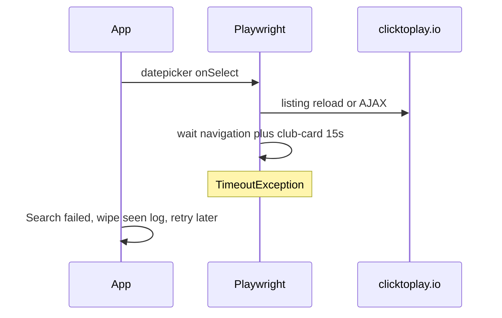

# Harden web inspection after calendar

## What the log shows

`%AppData%\ClickPlay\results-log.txt` at 08:07:

`Search failed (Selecting 2026-10-22 on the site calendar): TimeoutException: Timeout 15000ms exceeded` while waiting for `a.club-card`, with `waiting for navigation to finish` then a navigation to clicktoplay.io.

A person clicking the calendar only refreshes the listing. Automation calls jQuery `datepicker('setDate')` + `onSelect` in [`ClickToPlayBrowserSession.TryApplyDatepickerApiAsync`](src/ClickPlay.Core/Browser/ClickToPlayBrowserSession.cs), which can **submit/reload** the clubs page. Playwright then waits for that navigation **and** for `a.club-card` (15s) in [`WaitForListingAfterCalendarAsync`](src/ClickPlay.Core/Browser/ClickToPlayBrowserSession.cs). If the reload hangs or cards are late, the **whole Search cycle throws**, Results is cleared, and you see an empty/error window even though the loop keeps going.

SlowMo (800ms) is not the main bug. Manual search works because you wait until cards appear and you do not fire `onSelect` during a pending load (for example after `GoBack` from a club).

## Changes (no live-site tests)

All in [`ClickToPlayBrowserSession.cs`](src/ClickPlay.Core/Browser/ClickToPlayBrowserSession.cs) plus a short note in [`target_web.md`](target_web.md).

1. **Do not fail the whole search on a listing wait**  
   Catch `TimeoutException` and `PlaywrightException` around calendar listing waits. If cards never appear: **skip that day** (`SelectDayOnCalendarAsync` returns false) instead of throwing. Same idea after hour click.

2. **Wait like a person, not for navigation**  
   After calendar `onSelect`, do **not** rely on Playwright’s “wait for navigation to finish”. Prefer:
   - `WaitForLoadState(DOMContentLoaded)` with a short timeout, ignore failure
   - Then wait until `a.club-card` is **visible** (or count ≥ 1) up to ~30s
   - Optional: `WaitForResponse` on the clubs listing URL if one fires  
   Listing clicks (calendar day, hour option, club name row) use `NoWaitAfter = true` so a click does not block on a full navigation.

3. **Retry the calendar once**  
   If the first apply succeeds as ISO date but no cards: wait ~1s, call `onSelect` / setDate again, wait for cards. Still none → skip day.

4. **Stabilize after leaving a club**  
   After `GoBack` in `CollectVenueSlotsAsync`, wait until `input.find-club` and `a.club-card` are back before the next venue or next day. That is the usual time a calendar change races a half-loaded listing.

5. **Keep MySQL busy as a real stop-the-cycle error**  
   `ThrowIfSiteDatabaseBusyAsync` stays. Timeouts on cards are treated as “this day/listing not ready”, not as database-full.

6. **Tests**  
   No live clicktoplay.io. Extend fakes/ViewModel tests only if the skip-vs-throw contract is visible on `IClickToPlaySession`. Overlay-recovery tests stay as they are.

Keep current SlowMo/click pauses unless listing waits are solid; speed is separate from this race.
