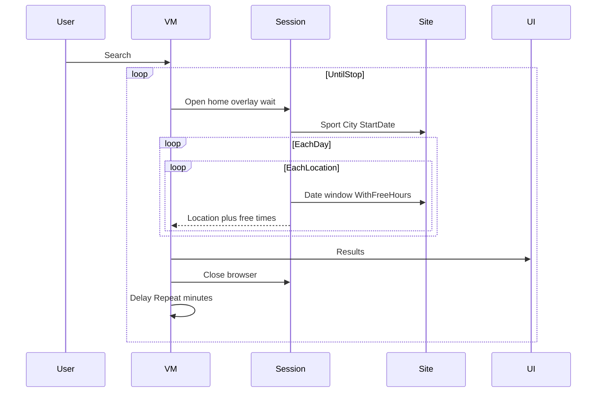

# Repeatable availability search loop

Treat **Repeat** as **wait minutes** (1–60) between full cycles, not a cycle count. Steps 6 and 8 are one close: after printing Results, dispose the browser, wait, then open again from step 1. Loop until the user clicks **Stop**. Do not log in or book ([target_web.md](target_web.md)).

## Cycle (one pass)

1. **Open** Chromium if closed (`StartAsync` + 2s settle + language overlay: **Български** then **Запази**, never **Приемам**).
2. **Navigate** to selected sport then city (existing `SelectSportAsync` / `SelectCityAsync`).
3. **Start day** = calendar `SelectedDate` (default today).
4. For **each selected location**, for the current date, find slots that can be reserved inside the matching window:
   - Weekdays (Mon–Fri, not holiday): weekday from/to boxes
   - Sat, Sun, or Bulgarian public holiday: weekend/holiday from/to boxes
   - Site: set date (`#sdate` / calendar), hour/window filters, **With free hours**; open the club card; parse visible free times only. No booking clicks.
5. Repeat step 4 for **Days ahead** consecutive dates: `Start` … `Start + (daysAhead - 1)` inclusive.
6. **Close** the Playwright browser/page (`DisposeAsync` / relaunch next cycle).
7. **Results**: clear then print lines `Location — yyyy-MM-dd HH:mm` (and duration/end if the site shows a range). Status text while running (e.g. “Checking Amik Sport, 2026-10-19…”).
8. **Wait** `Repeat` minutes (`Task.Delay` + `CancellationToken`), then go to step 1.

## App wiring

- [`MainViewModel.cs`](src/ClickPlay.App/ViewModels/MainViewModel.cs): `Search` becomes `async` loop; add **Stop** (`Cancel` CTS). Disable Search while running; enable Stop. Relabel Repeat in [`MainWindow.axaml`](src/ClickPlay.App/Views/MainWindow.axaml) to **Repeat (minutes)**. Keep Headless for each reopen.
- [`IClickToPlaySession.cs`](src/ClickPlay.Core/Services/IClickToPlaySession.cs): add `SearchAvailabilityAsync(SearchRequest, IProgress, CancellationToken)` returning slot list. Implement in [`ClickToPlayBrowserSession.cs`](src/ClickPlay.Core/Browser/ClickToPlayBrowserSession.cs). Playwright stays off the UI thread; collection updates on the dispatcher.
- New Core types: `AvailabilitySlot(Location, Date, From, To?)`; `BulgarianHolidayCalendar` (fixed public holidays + Orthodox Easter-dependent dates used in BG, no Windows-only APIs).
- Reuse existing overlay, sport/city, club-card locators. Fail with a clear “layout changed” message if free-hour UI is missing.

## Tests (no live site)

Fake session: given Start + daysAhead, weekday vs weekend/holiday windows, selected locations → expected slot lines; Repeat minutes is parsed 1–60; Search disabled while busy; Stop cancels delay without hanging. Holiday date picks weekend window. SMTP unchanged / still not required for this slice.
