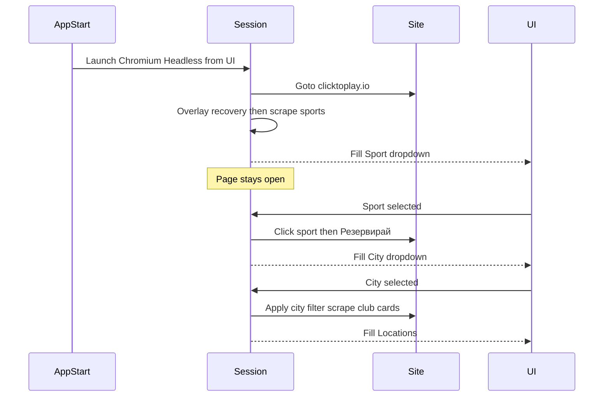

# Startup sequence: live sports, cities, locations

Replace the placeholder catalog with a **single Playwright page** that stays open until the app exits. The existing ViewModel cascade in [`MainViewModel.cs`](src/ClickPlay.App/ViewModels/MainViewModel.cs) already loads cities on sport change and venues on city change; it will call a live session instead of [`PlaceholderClickToPlayCatalog`](src/ClickPlay.Core/Services/PlaceholderClickToPlayCatalog.cs).

Follow [`target_web.md`](target_web.md) (Bulgarian locators, overlay recovery, no login/booking/cookies accept) and [`AGENTS.md`](AGENTS.md) (Playwright only, off UI thread, `Headless` from the UI).

## Session (keep page open)

Add `ClickPlay.Core` types:

- [`BrowserLaunchOptions`](src/ClickPlay.Core/Models/BrowserLaunchOptions.cs) already has `Headless`
- `IClickToPlaySession` : `StartAsync(BrowserLaunchOptions)`, `GetSportsAsync`, `SelectSportAsync(Sport)`, `SelectCityAsync(City)`, `IAsyncDisposable`
- `ClickToPlayBrowserSession` holds `IPlaywright`, `IBrowser`, `IBrowserContext`, `IPage` for the **whole app lifetime**. Do **not** close the page after filling Sports, Cities, or Locations. Dispose only on app shutdown.

Package: `Microsoft.Playwright` on Core.

`StartAsync`:

1. `await Playwright.CreateAsync()` / `Chromium.LaunchAsync(new() { Headless = options.Headless })`
2. `page.GotoAsync("https://clicktoplay.io/")`
3. Overlay helper per [`target_web.md`](target_web.md): if sports bar is not clickable, select **Български** then **Запази** when those controls are **visible**. Do **not** click **Приемам**. Wait for overlays to leave. Retry sports panel once. On failure: screenshot + log URL/title under app-data diagnostics (not a hardcoded path).
4. Scrape unique sport names from `.sport-container` / nav (visible or via text). Validate non-empty names.
5. Return sports; **leave the browser open**.

If `Headless` changes after start, restart the session on the next **Load sports** (one recrate). Do not restart on every sport/city click.

## Sport selected

`SelectSportAsync`:

- On the **same page** (goto home only if not already on clicktoplay.io)
- Click the matching sport (text **Тенис** / **Падел** / …)
- Click **Резервирай** / **Резервирай корт** (visibility check first)
- Wait for clubs UI (`https://clicktoplay.io/clubs/index.php` or city filter)
- Read **Град** / city options; skip placeholders like empty or “Current location”
- Validate names; fill City dropdown; clear Locations

## City selected

`SelectCityAsync` on the **same clubs page** (if the page was left, re-run sport + Резервирай first):

- Select the city in the filter
- Collect **all** club/venue cards (name + address). Scroll if the list lazy-loads
- Validate; fill Locations (multi-select unchanged)

## App wiring

- [`App.axaml.cs`](src/ClickPlay.App/App.axaml.cs): construct `ClickToPlayBrowserSession`, inject into `MainViewModel`, `DisposeAsync` on `Exit` / shutdown. Still no Playwright in code-behind of `MainWindow`.
- `MainViewModel`: drop `PlaceholderClickToPlayCatalog` as the default; pass the session (or a thin `PlaywrightClickToPlayCatalog` adapter implementing `IClickToPlayCatalog`). `LoadSportsAsync` calls `StartAsync(BrowserLaunchOptions)` then `GetSportsAsync`. `LoadCitiesAsync` / `LoadVenuesAsync` already exist—point them at the session.
- Keep Opened → `LoadSportsCommand` so startup fills Sports automatically.
- Status text: “Loading sports…”, “Loading cities…”, “Loading locations…”, plus errors if the layout changed.
- Document `pwsh .../playwright.ps1 install chromium` for Win/Mac.

## Tests

- Unit tests with a fake `IClickToPlaySession` (no live site): sport change clears/fills cities; city change fills locations; Search stays disabled until a location is checked.
- Overlay helper tests: skip **Запази** when not visible; never click **Приемам**.
- Do not add a live clicktoplay.io test in CI.

## Out of scope for this slice

Availability search by days/time windows and SMTP send (session stays open so a later search can reuse the page).
